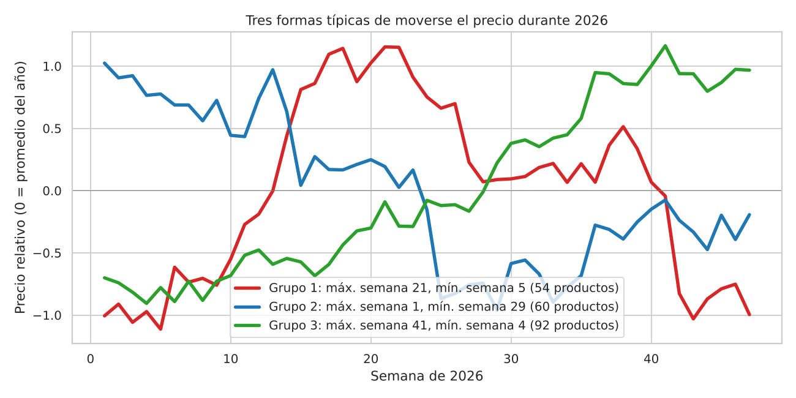
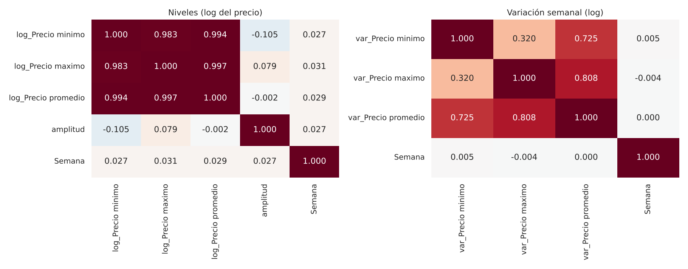
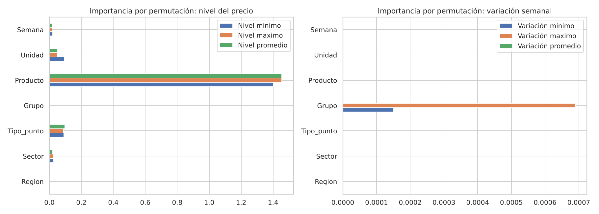
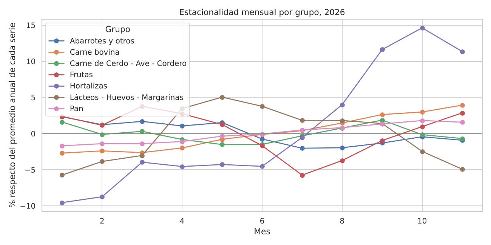

# Análisis de precios al consumidor en Chile, 2026

Análisis exploratorio y de aprendizaje automático sobre el **detalle semanal de precios al consumidor** publicado por **ODEPA** (Oficina de Estudios y Políticas Agrarias, Ministerio de Agricultura) en el portal de datos abiertos del Gobierno de Chile, [datos.gob.cl](https://datos.gob.cl/dataset/precios-consumidor2).

Los datos corresponden a precios de alimentos de la canasta familiar (hortalizas, frutas, carnes, lácteos y huevos, pan y abarrotes) medidos en supermercados, ferias libres, carnicerías, panaderías y mercados de 9 regiones, desde la semana 1 (29-dic-2025) hasta la semana 47 (20-nov-2026).

## Resultado principal: tres patrones de precio durante el año

Agrupé 206 productos según la forma en que se mueve su precio a lo largo de 2026 (clustering con K-means), sin importar cuánto cuestan.



- **Grupo 3, "sube hacia la primavera" (92 productos):** hortalizas, carne bovina y algunas frutas. Están baratos en enero y llegan al máximo en octubre.
- **Grupo 2, "baja durante el año" (60 productos):** sobre todo abarrotes como legumbres, además de limón y manzana. Parten caros y llegan al mínimo en julio.
- **Grupo 1, "huevos y lácteos" (54 productos):** pico a mitad de año, con un salto marcado en Semana Santa.

La separación es moderada (coeficiente de silueta 0,26), por lo que estos grupos describen tendencias y no categorías cerradas.

## Qué contiene el análisis

| Etapa | Qué se hizo |
|---|---|
| Calidad de datos | Nulos, duplicados, coherencia entre precio mínimo, máximo y promedio |
| Correlaciones | Matriz de correlación de niveles y de variaciones semanales |
| Importancia de variables | XGBoost con importancia por permutación, para el nivel y para la variación semanal |
| Calendario | Efecto de Semana Santa, Fiestas Patrias, vacaciones de invierno y otros eventos |
| Estacionalidad | Precio relativo por mes y grupo de producto |
| Clustering | K-means sobre la curva de precio anual de cada producto |

El análisis completo, con interpretación y limitaciones, está en [reports/analisis.md](reports/analisis.md). El código está en [notebooks/01_analisis_precios_consumidor_2026.ipynb](notebooks/01_analisis_precios_consumidor_2026.ipynb), ya ejecutado.

## Algunos gráficos





## Cómo reproducirlo

```bash
pip install -r requirements.txt
# descargar el CSV (ver data/LEEME.txt) y dejarlo en data/
jupyter notebook notebooks/01_analisis_precios_consumidor_2026.ipynb
```

## Estructura

```
data/        instrucciones para obtener el CSV (el archivo no se sube por su tamaño)
notebooks/   cuaderno con todo el análisis, ejecutado
reports/     gráficos, tablas de resultados y análisis escrito
```

## Fuente y licencia

- Datos: ODEPA, Ministerio de Agricultura de Chile, vía datos.gob.cl, licencia Creative Commons Attribution (CC-BY).
- Código: licencia MIT.
- Este es un proyecto de portafolio con fines de análisis de datos. No es una publicación oficial de ODEPA.
